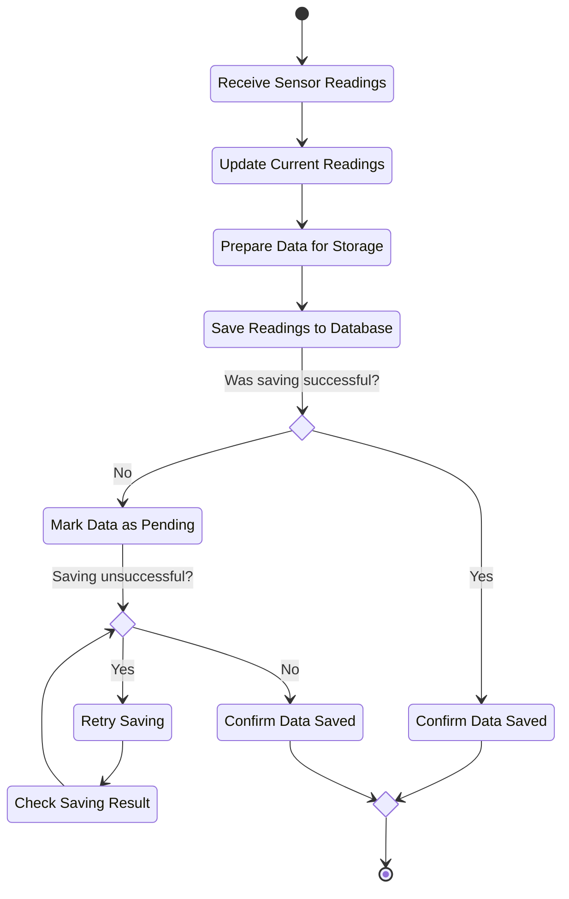

# Smart Environment Station

## Activity Diagram 1: ESP32 Initialization & Sensor Check
> Eng. Omar Ismail

Based on Sequence Diagram 5 (Sensor Connection Testing), Sequence Diagram 3 (Read DHT11 Sensor Data) and Sequence Diagram 2 (Read TEMT6000 Sensor Data), at a higher level of abstraction (GPIO details omitted). The DHT11 and TEMT6000 tests run in parallel (fork/join). If both sensors are connected, the ESP32 reads both sensors in parallel (fork/join) and prepares the readings to be sent. If at least one sensor is not connected, the ESP32 collects the status of both sensors in parallel (fork/join) and reports the sensor fault. The two outcome branches mirror each other.

---
## Diagram 2: Connection Request & Device Scan

Based on Sequence Diagram 1 (Request Connection Flow) and Sequence Diagram 4 (Device Scan Flow). After the user opens the app, a decision selects which action the user takes: request a connection (left branch) or request a device scan (right branch). The two paths merge again before the end.

---
## Diagram 5 - Threshold Alert Decision and Alert Suppression
> Eng. Abdullah Mahmoud

## Diagram 8 - Environmental Data Synchronization

