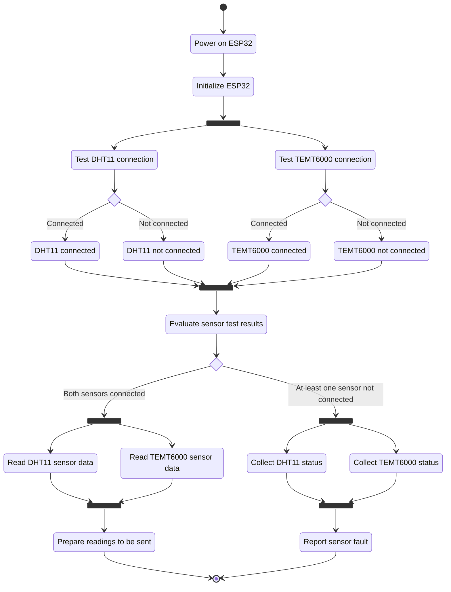
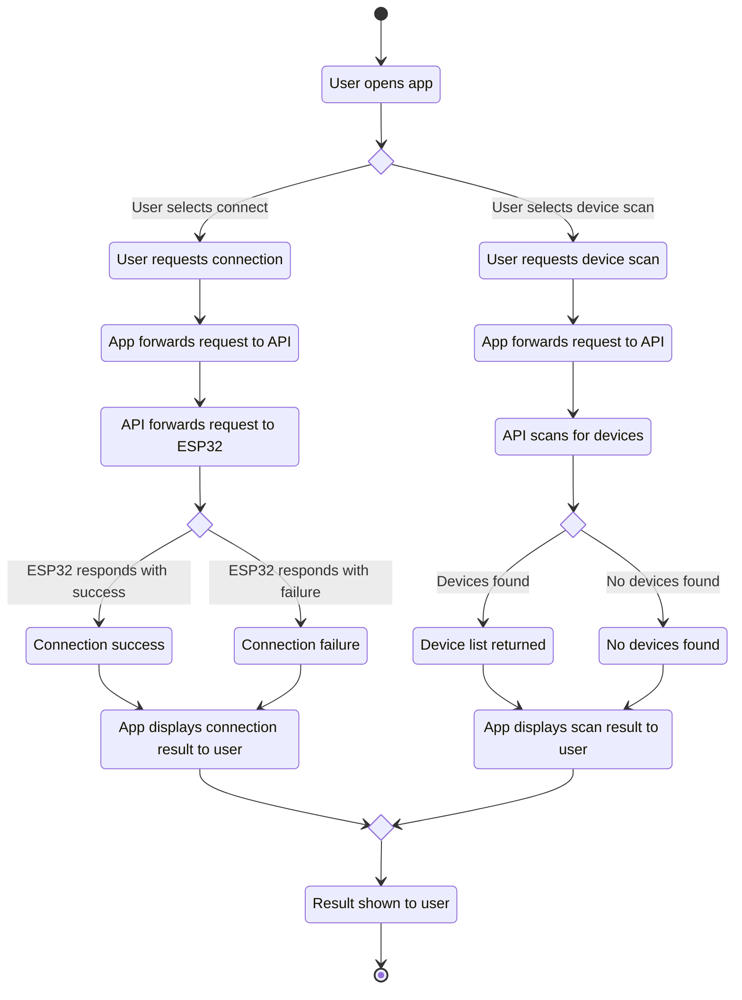
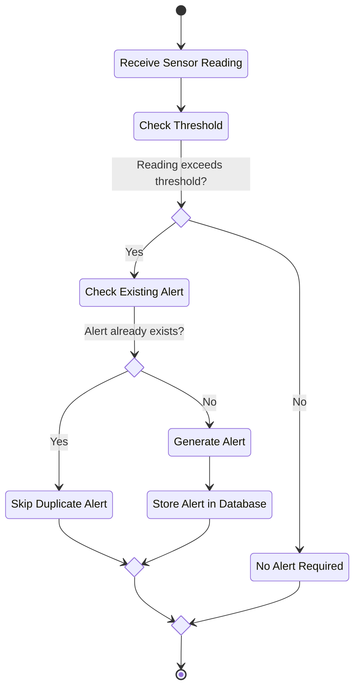
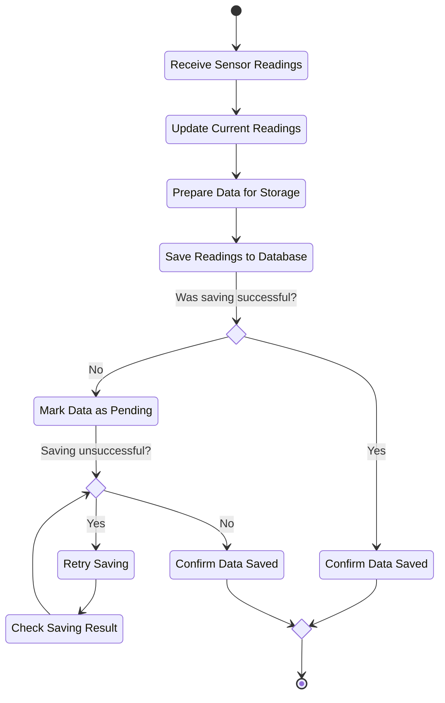
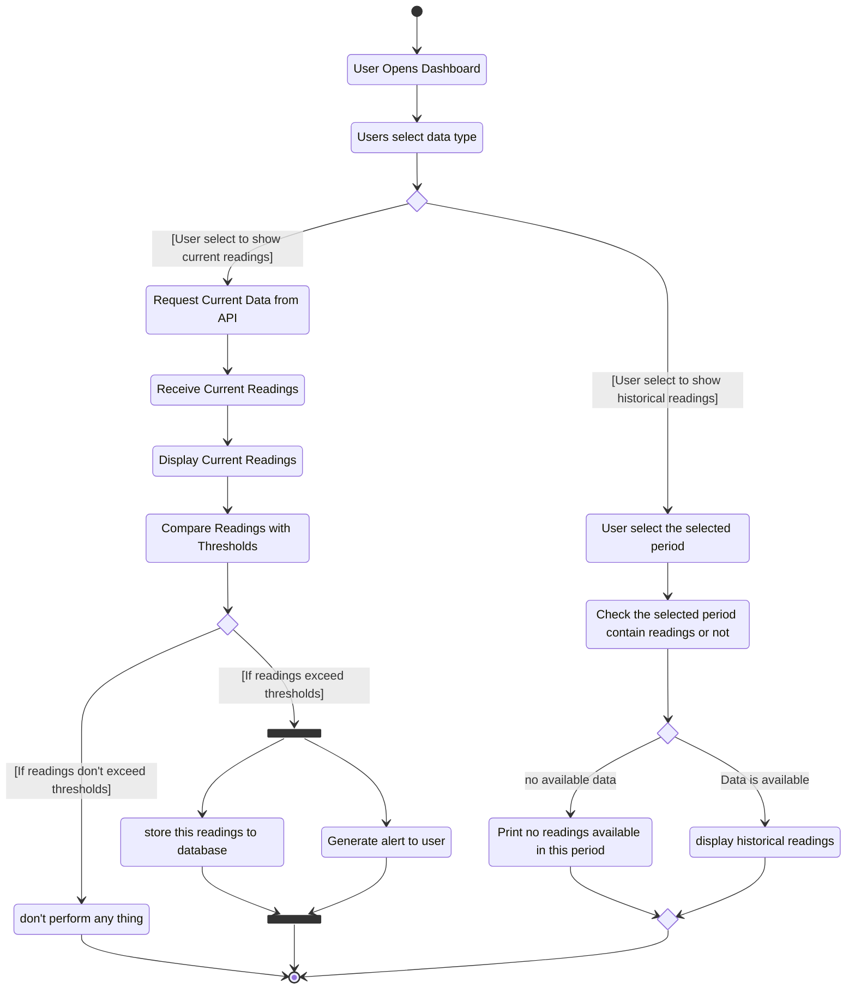
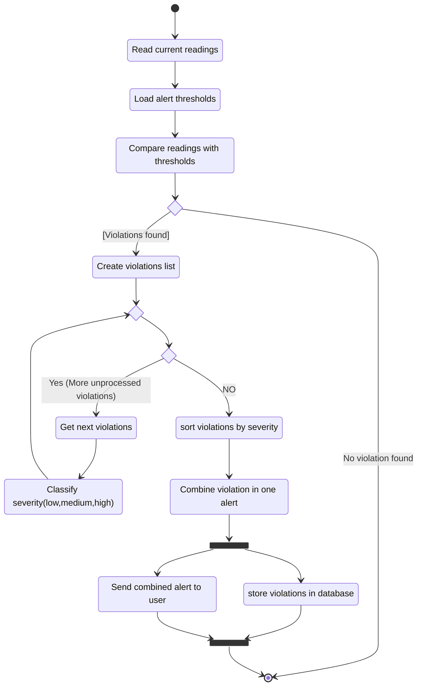
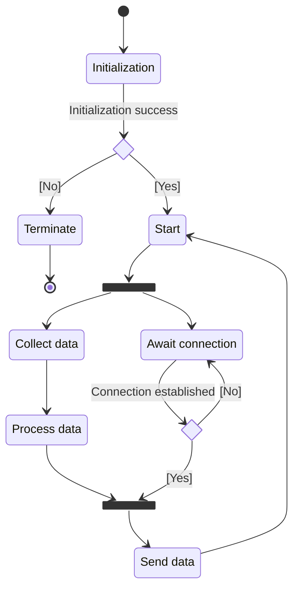
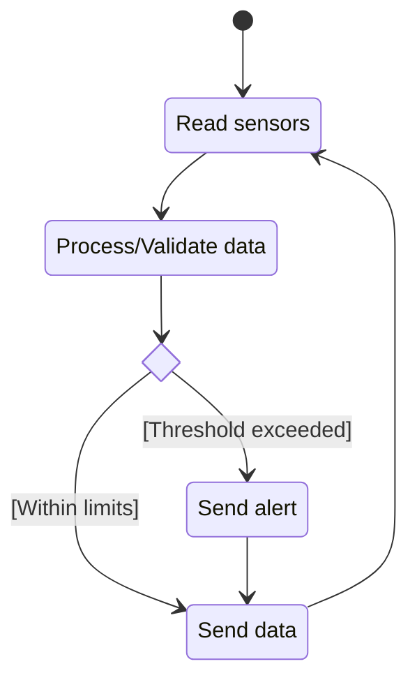

# Smart Environment Station - Activity Diagrams
## This document contains the activity diagrams for the Smart Environment Station project. Each diagram represents a specific workflow or process within the system, providing a visual representation of the activities and their interactions.
- [Diagram 1](#diagram-1---dashboard-readings-and-alert-flow), [Diagram 4](#diagram-4---handling-multiple-threshold-violations) Eng. Omar Emad
- [Diagram 2](#diagram-2-esp32-initialization--sensor-check), [Diagram 3](#diagram-3-connection-request--device-scan) Eng. Omar Ismail
- [Diagram 5](#diagram-5---threshold-alert-decision-and-alert-suppression), [Diagram 6](#diagram-6---environmental-data-synchronization) Eng. Abdullah Mahmoud
- [Diagram 7](#diagram-7---environmental-monitoring-session-life-cycle), [Diagram 8](#Diagram-8---Threshold-checking) Eng. Omar Tamer

## Diagram 2: ESP32 Initialization & Sensor Check
> Eng. Omar Ismail

Based on Sequence Diagram 5 (Sensor Connection Testing), Sequence Diagram 3 (Read DHT11 Sensor Data) and Sequence Diagram 2 (Read TEMT6000 Sensor Data), at a higher level of abstraction (GPIO details omitted). The DHT11 and TEMT6000 tests run in parallel (fork/join). If both sensors are connected, the ESP32 reads both sensors in parallel (fork/join) and prepares the readings to be sent. If at least one sensor is not connected, the ESP32 collects the status of both sensors in parallel (fork/join) and reports the sensor fault. The two outcome branches mirror each other.

---
## Diagram 3: Connection Request & Device Scan

Based on Sequence Diagram 1 (Request Connection Flow) and Sequence Diagram 4 (Device Scan Flow). After the user opens the app, a decision selects which action the user takes: request a connection (left branch) or request a device scan (right branch). The two paths merge again before the end.

---
## Diagram 5 - Threshold Alert Decision and Alert Suppression
> Eng. Abdullah Mahmoud

## Diagram 6 - Environmental Data Synchronization

---
## Diagram 1 - Dashboard Readings and Alert Flow
> Eng. Omar Emad

## Diagram 4 - Handling multiple threshold violations 

---
## Diagram 7 - Environmental Monitoring session life cycle
> Eng. Omar Tamer

## Diagram 8 - Threshold checking

