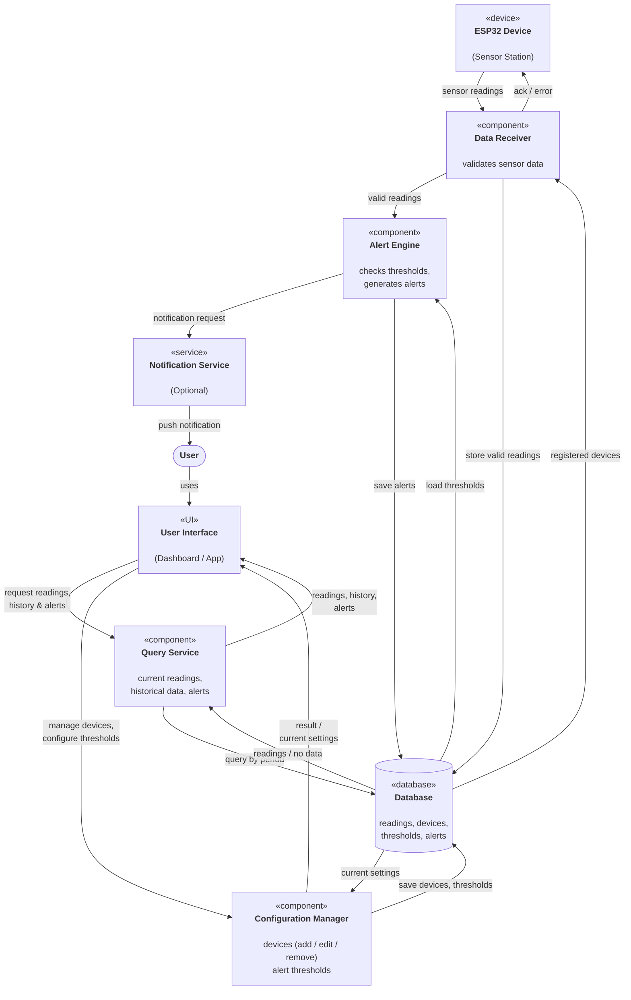

## Smart Environment Station - Architecture Diagrams
# This document contains the architecture diagrams for the Smart Environment Station project. Each diagram represents a specific component or aspect of the system, providing a visual representation of the architecture and its interactions.

---
