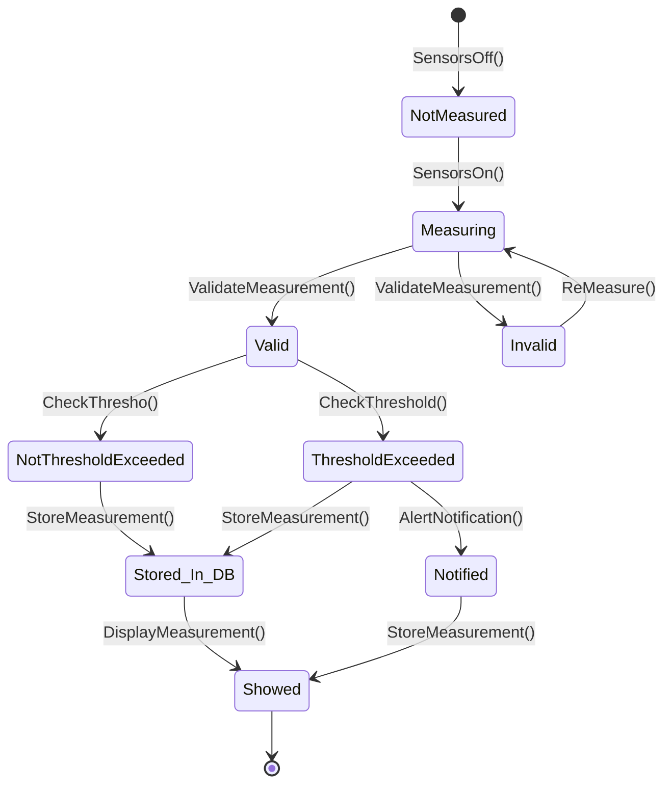

# Smart Environment - measurements lifecycle - State Diagram
This model represents the lifecycle of a measurements in a smart environment system. It illustrates the various states a measurement can be in, as well as the transitions between these states.
---
## Visual Representation

## State Difinitions
| State | Description | Entry / Do / Exit Behaviors |
| :--- | :--- | :--- |
| **NotMeasured** | The measurements have not been taken yet. | `Entry: SensorsOff()` |
| **Measuring** | The measurements are currently being taken. | `Entry: SensorsOn()` |
| **Valid** | The measurements are valid. | `Entry: ValidateMeasurement()` |
| **Invalid** | The measurements are invalid. | `Entry: ValidateMeasurement()` |
| **Stored_In_DB** | The measurements are stored in the database. | `Entry: StoreMeasurement()` |
| **Showed** | The measurements are displayed. | `Entry: DisplayMeasurement()` |
| **ThresholdExceeded** | The measurements have exceeded the threshold. | `Entry: CheckThreshold()` |
| **NotThresholdExceeded** | The measurements have not exceeded the threshold. | `Entry: CheckThreshold()` |
| **Notified** | An alert has been notified. | `Entry: AlertNotification()` |