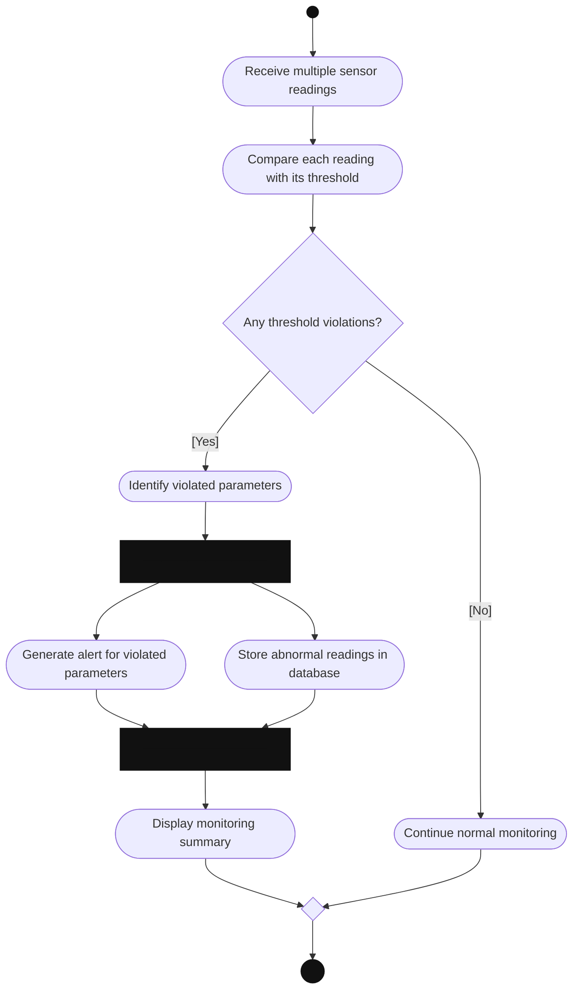
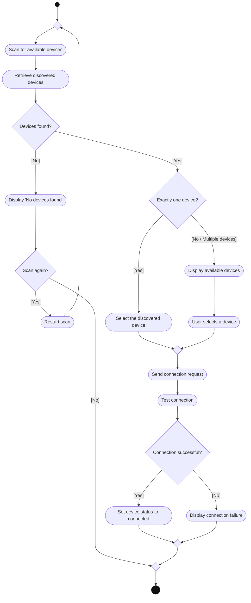
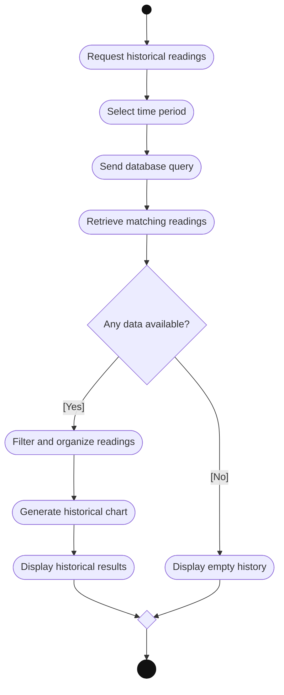
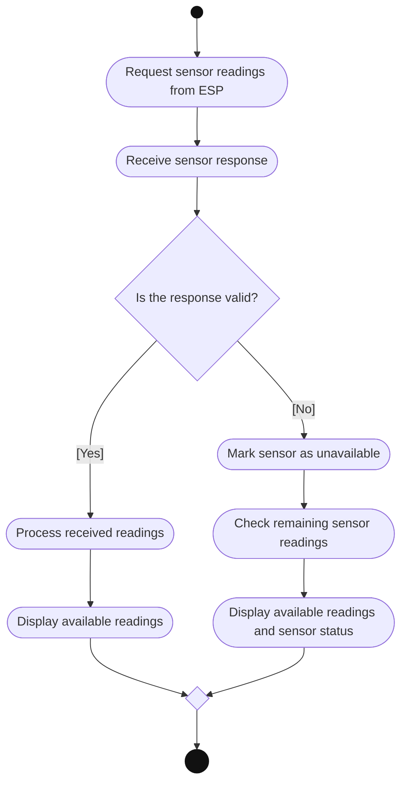
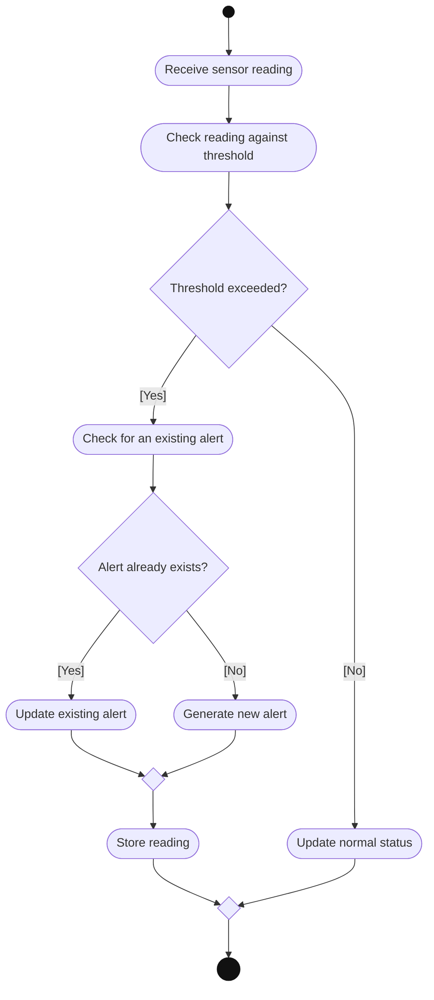
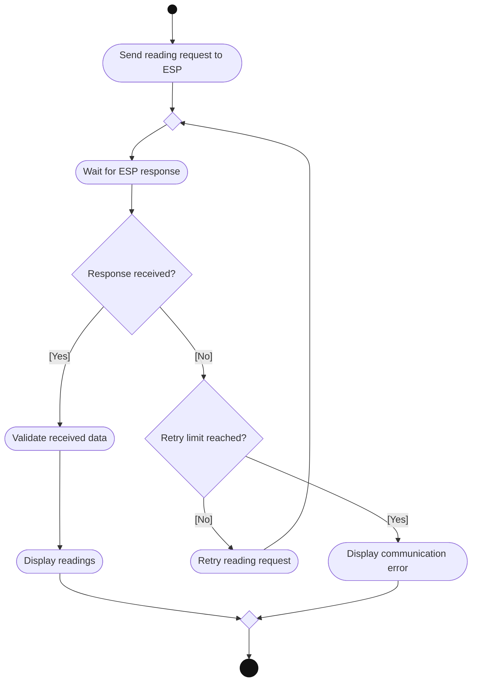
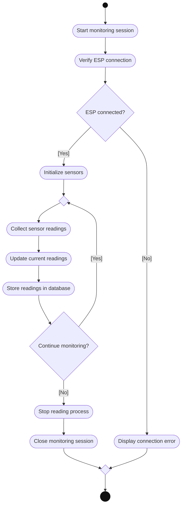
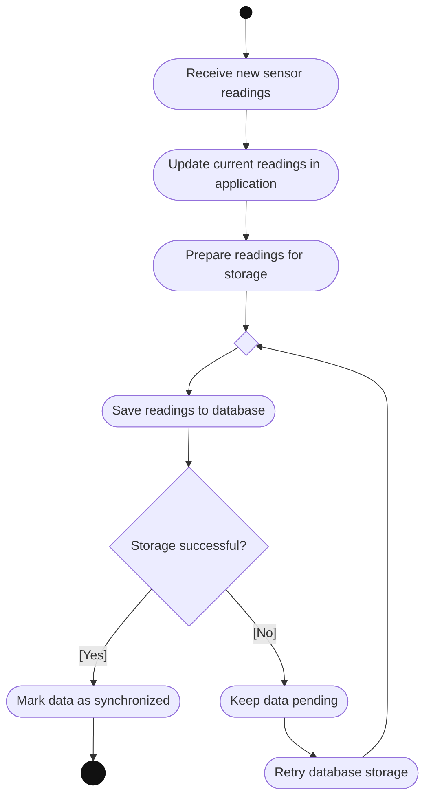

# Smart Environment Station — UML Activity Diagrams

This file models the **eight activity-diagram workflows** for the Smart Environment Station using **Mermaid (`flowchart TD`) with strict UML 2.x Activity Diagram design constraints**.

Because Mermaid does not have a dedicated `activityDiagram` keyword, standard UML 2.x semantics are enforced through the following structural conventions:
* **Initial (`●`) and Activity-Final (`◉`) Nodes:** Rendered as a solid filled circle `Start((" "))` and a double-circle bullseye `Stop(((" ")))`.
* **Action Nodes (`([Action])`):** Stadium-shaped nodes labeled with active verb phrases.
* **Separate Decision and Merge Diamonds (`{ }`):** Decision nodes accept **one incoming** flow and emit **two or more guarded** outgoing flows (`"[Guard]"`). Empty Merge diamonds (`{" "}`) reunite alternative branches or loop re-entries so flows never merge directly into an action or decision node.
* **Fork and Join Synchronization Bars (`▬`):** Parallel branches split from a solid black Fork bar and synchronize at a matching Join bar before continuing.

> **Scope note:** These diagrams are based on the Smart Environment Station functions discussed: ESP discovery and connection, sensor readings, current and historical readings, threshold checking, alerts, and database storage. Some branches are optional assumptions, identified below. Keep them only if they match the actual requirements and sequence diagrams.

---

## 1. Multiple Threshold Violations

**Purpose:** Evaluate readings from multiple sensors and handle more than one threshold violation in a monitoring cycle.

**UML elements:** Initial node, decision/merge nodes, fork and join synchronization bars, activity-final node.

**Condition:** Use this workflow if the system evaluates readings from more than one sensor in the same monitoring cycle.

---

## 2. Device Selection Based on Scan Results

**Purpose:** Show different outcomes depending on the number of ESP devices found during scanning.

**UML elements:** Nested decisions, dedicated merge nodes, alternative paths, and a scan retry loop.

**Condition:** Automatic selection when exactly one device is found is an assumption. Keep it only if that behavior is supported by the system design.

---

## 3. Historical Readings Filtering

**Purpose:** Retrieve readings for a selected time period and handle an empty database result.

**UML elements:** Decision and merge of the data-available and empty-result paths.

---

## 4. Sensor Failure Handling During Reading

**Purpose:** Show how the app handles a sensor that does not provide a usable response.

**UML elements:** Decision and merge with success and failure paths.

**Condition:** Use this only if the system can identify an unavailable or invalid sensor response and continue with other sensors.

---

## 5. Threshold Alert Decision and Alert Suppression

**Purpose:** Avoid generating a duplicate alert when an alert for the same threshold violation already exists.

**UML elements:** Nested decisions, dedicated merge nodes, and alternative alert-handling paths.

**Important:** Checking for an existing alert, updating it, and suppressing duplicates were not confirmed as existing system functions. Treat this as an optional design idea unless those behaviors are present in the requirements or implementation.

---

## 6. Interrupted Reading Request

**Purpose:** Handle a reading request when the ESP does not respond.

**UML elements:** Loop merge node, decisions, and alternative success/failure paths.

**Condition:** Include a retry limit only if the application has a defined retry policy. Otherwise, model failure handling according to the actual sequence diagram.

---

## 7. Environmental Monitoring Session Lifecycle

**Purpose:** Represent a monitoring session from initialization through repeated reading cycles to termination.

**UML elements:** Decisions, repeated activity loop with merge node, and activity-final node.

**Important:** A user-controlled start/stop session and explicit session-closing behavior were not confirmed in the functions listed so far. Keep this diagram only if the system actually supports those actions.

---

## 8. Environmental Data Synchronization

**Purpose:** Represent sending readings from the application to the database and checking whether storage succeeded.

**UML elements:** Decision, merge node, and database write retry loop.

**Important:** Storage confirmation, pending-data status, and retrying database writes were not confirmed as existing system behaviors. Include them only if they are part of the implementation or approved requirements.

---

## Summary

| # | Activity diagram | Main UML modeling idea |
|---|---|---|
| 1 | Multiple Threshold Violations | Parallel alert generation and database storage (`fork` / `join`) |
| 2 | Device Selection Based on Scan Results | Branching by number of discovered devices and scan retry loop |
| 3 | Historical Readings Filtering | Data available versus empty result |
| 4 | Sensor Failure Handling During Reading | Failure path while handling sensor data |
| 5 | Threshold Alert Decision and Alert Suppression | Nested decisions for duplicate alerts |
| 6 | Interrupted Reading Request | Retry loop and communication failure |
| 7 | Environmental Monitoring Session Lifecycle | Repeated monitoring cycle |
| 8 | Environmental Data Synchronization | Database write confirmation and retry |

## Rendering the diagrams

The code blocks use **Mermaid** (`mermaid`), which renders natively in most modern Markdown environments:
* **GitHub & GitLab:** Automatically render `mermaid` blocks directly inside the README preview.
* **VS Code:** Supported natively in the built-in Markdown preview (`Ctrl+Shift+V` / `Cmd+Shift+V`) or via the **Markdown Preview Mermaid Support** extension.
* **Online Export:** Paste any block into **Mermaid Live Editor** (`mermaid.live`) to export high-resolution PNG or SVG images.

## Before using these diagrams in the project

- Keep each activity consistent with the system's actual sequence diagrams and requirements.
- Do not present optional assumptions as implemented functionality.
- Use fork/join synchronization bars only for genuinely parallel actions.
- Keep decision diamonds (1 incoming, 2+ guarded outgoing) separate from merge diamonds (2+ incoming, 1 outgoing).
- Rename actions to match the exact terminology used in the project.