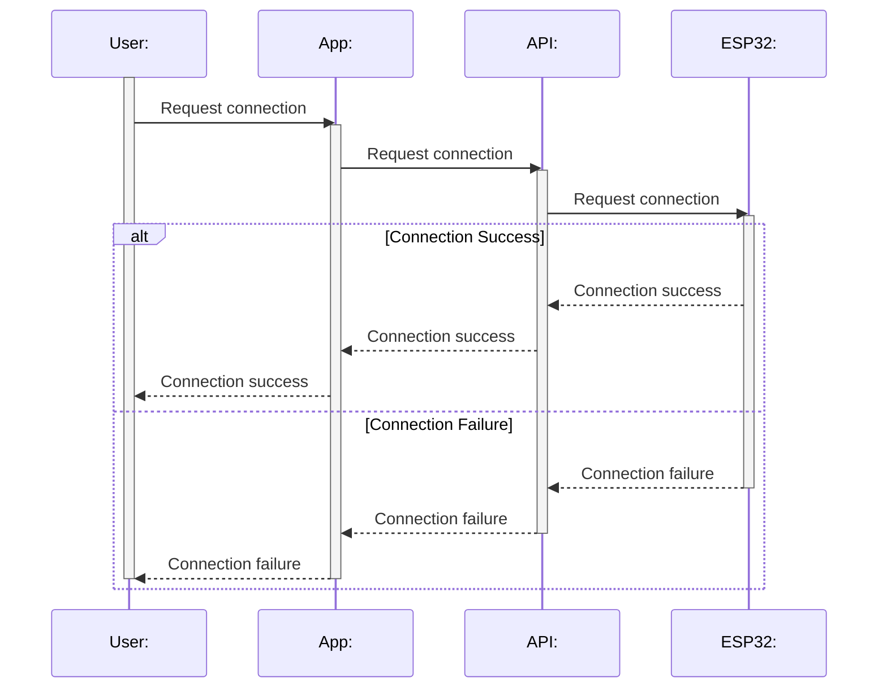
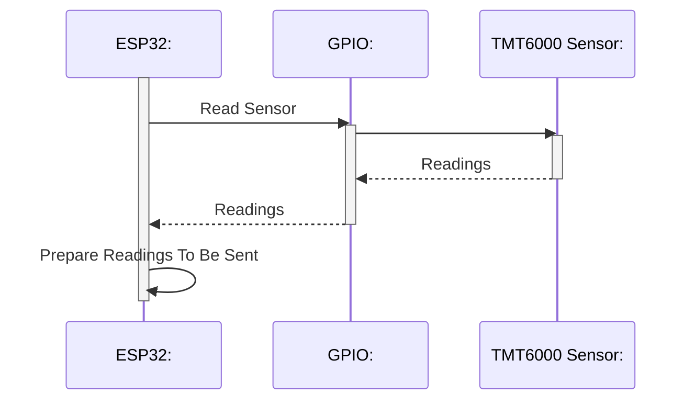
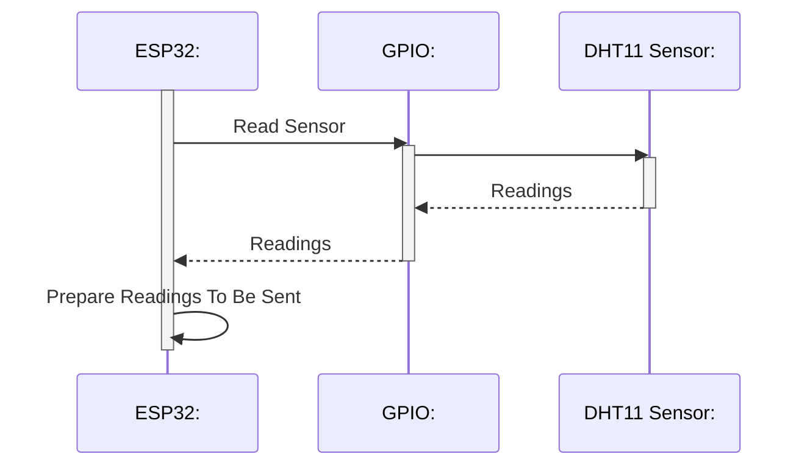
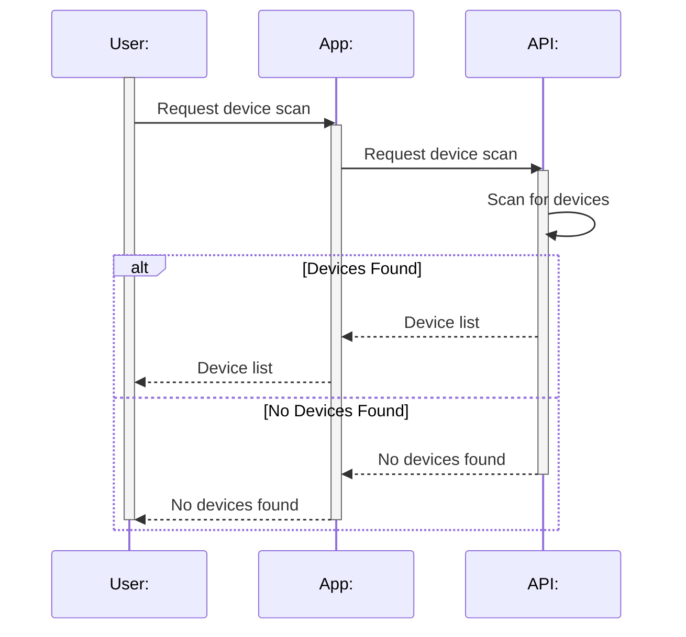
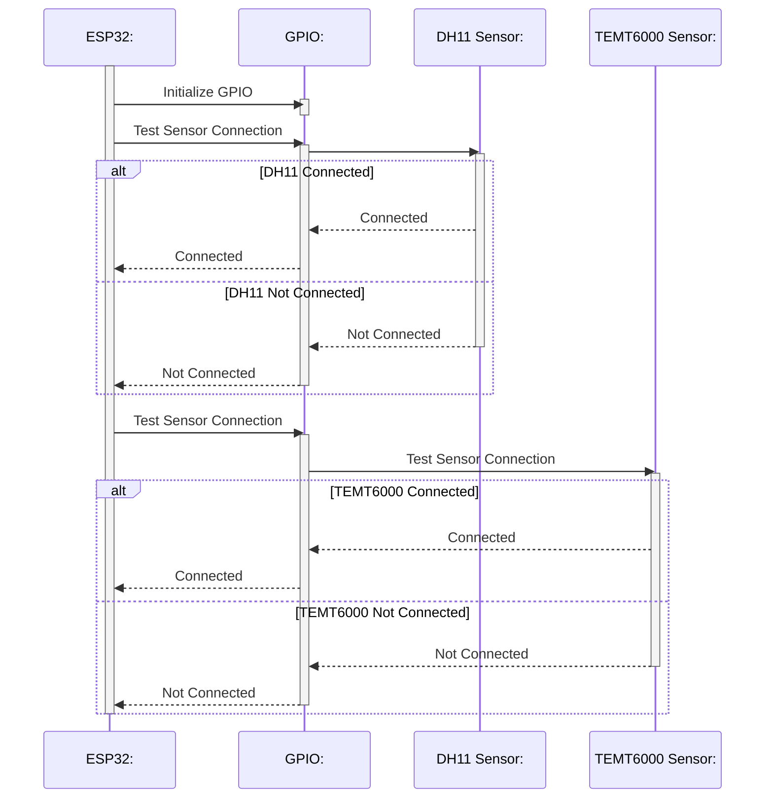
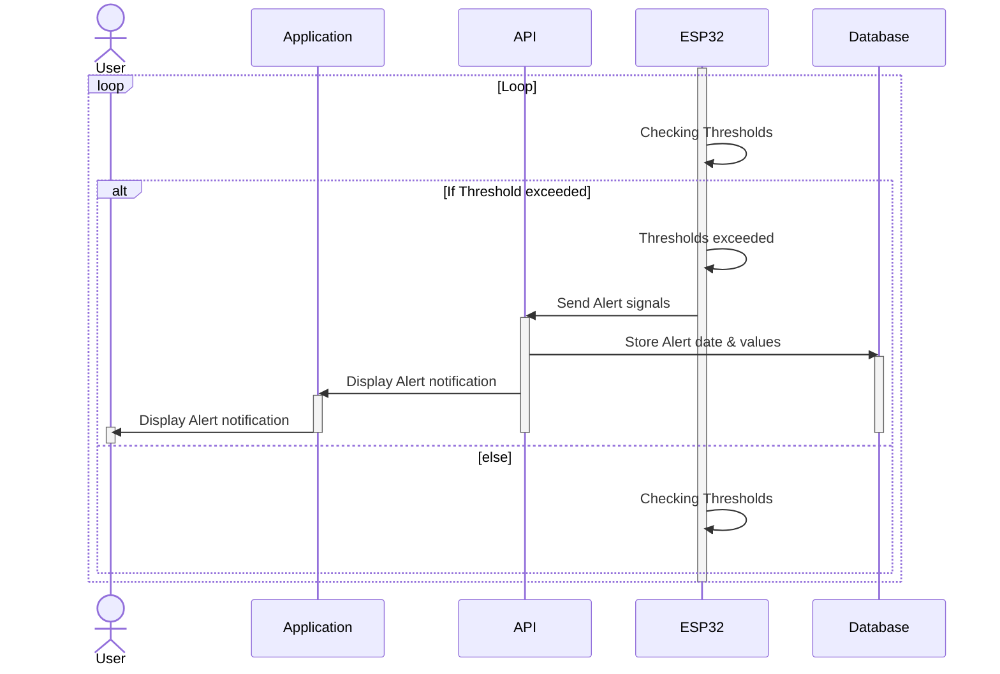
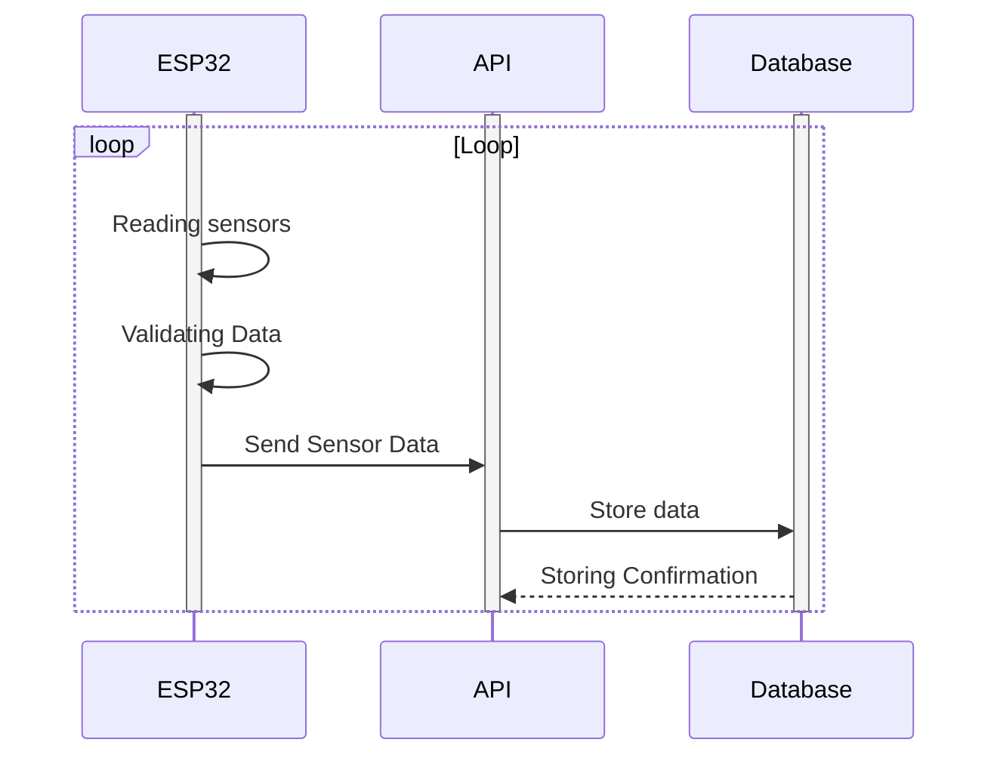
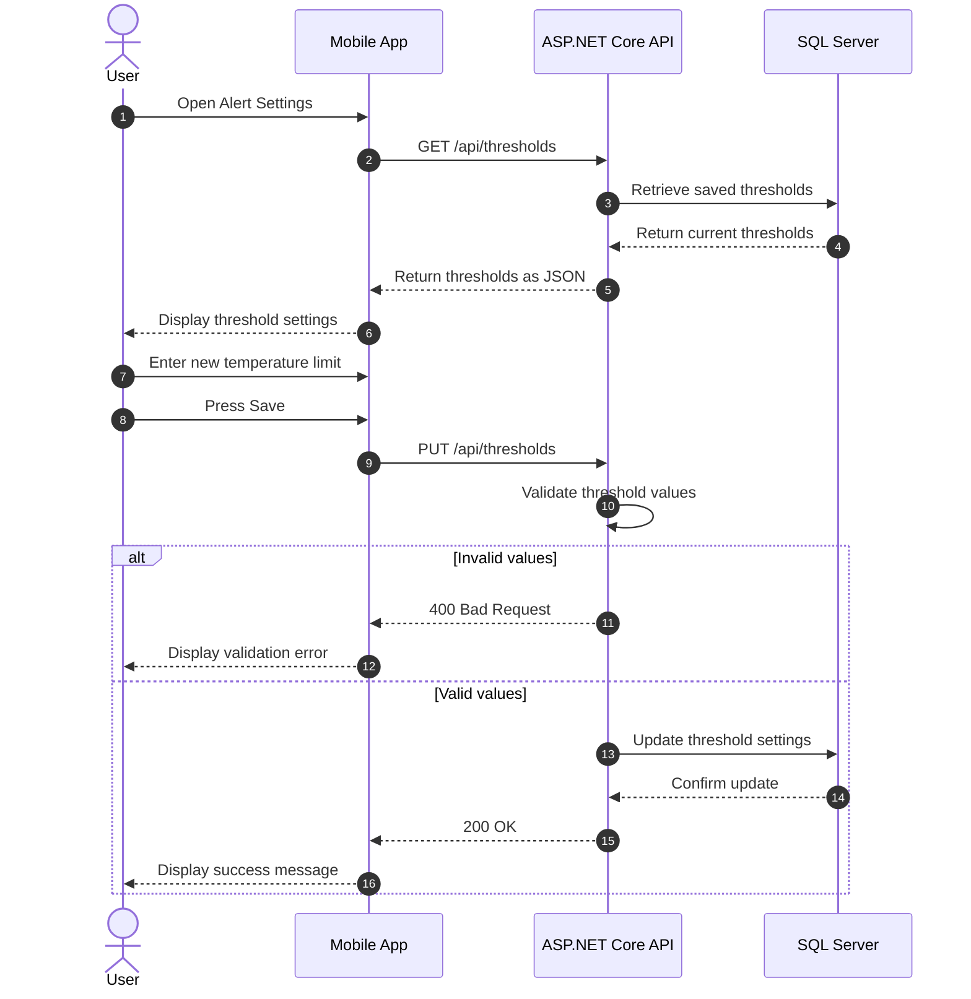
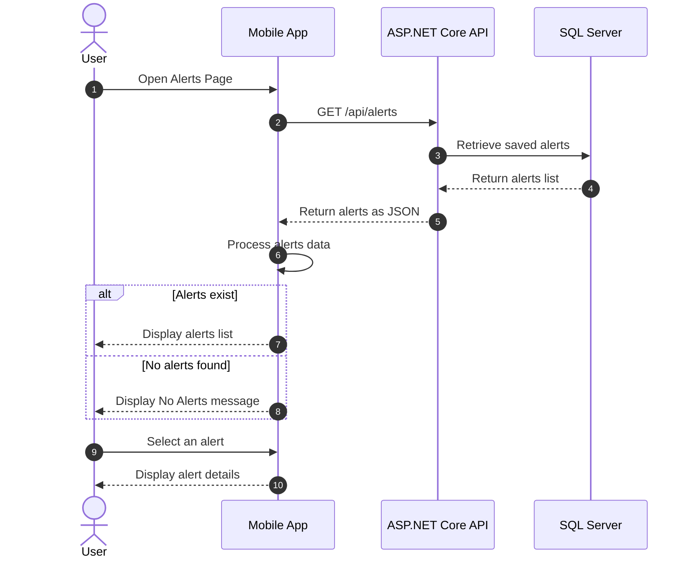

# Smart Environment station  
## Sequence Diagrams:
> First 5 for student: Omar Tamer
### 1: Request Connection Flow

### 2: Read TMT6000 Sensor Data

### 3: Read DHT11 Sensor Data

### 4: Device Scan Flow

### 5: Sensor Connection Testing

> 6, 7 Student: Omar Ismail
### 6: Alert Notification Loop

### 7: Send sensor data

> 8, 9 student: [Abdullah Mahmoud](https://github.com/AbdullahMahmoud206)
### 8: Configure Alert Thresholds

### 9: View Alerts

