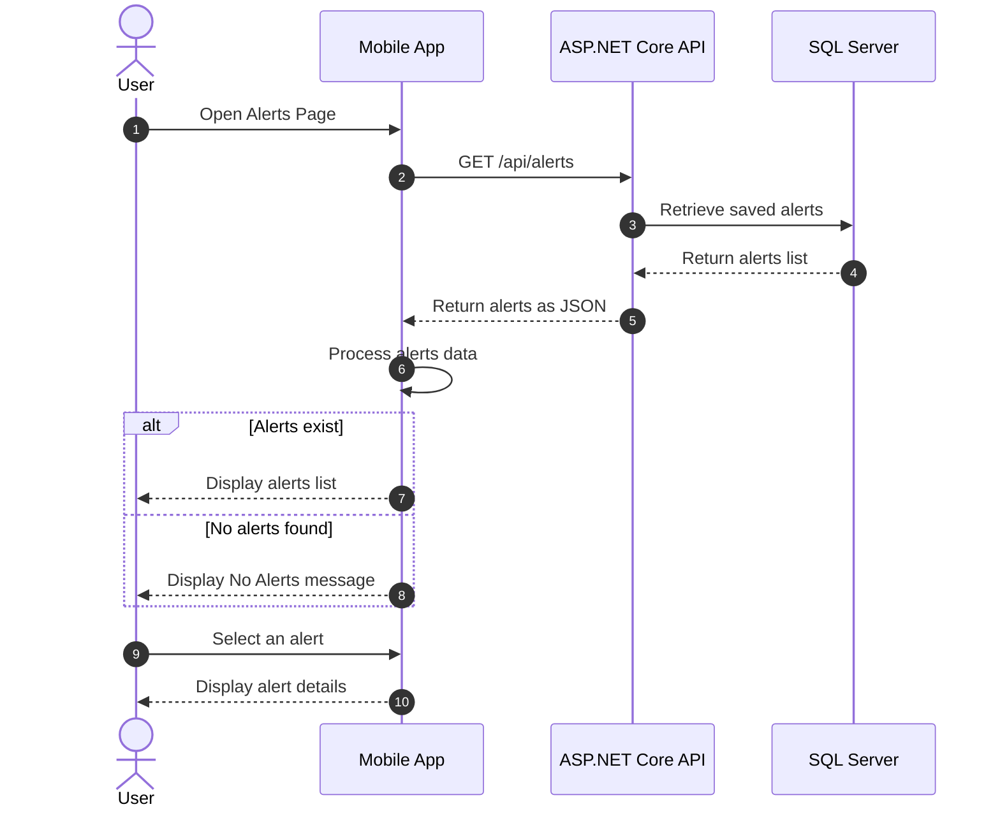

# Sequence Diagrams:

## Diagram 1: Request Connection Flow
```mermaid
sequenceDiagram
    participant User as User:
    participant App as App:
    participant API as API:
    participant ESP32 as ESP32:

    activate User
    User->>App: Request connection
    activate App
    App->>API: Request connection
    activate API
    API->>ESP32: Request connection
    activate ESP32

    alt Connection Success
        ESP32-->>API: Connection success
        API-->>App: Connection success
        App-->>User: Connection success
    else Connection Failure
        ESP32-->>API: Connection failure
        deactivate ESP32
        API-->>App: Connection failure
        deactivate API
        App-->>User: Connection failure
        deactivate App
        deactivate User
    end
```[cite: 4]


## Diagram 5: Configure Alert Thresholds
### Participants:
- **User:** The user who defines the alert boundaries.

- **Mobile App:** The mobile application that displays and sends the settings.

- **ASP.NET Core API:** Receives the request and verifies the values.

- **SQL Server:** Saves the alert boundaries in the database.
```mermaid
   
sequenceDiagram
    autonumber
    actor U as User
    participant App as Mobile App
    participant API as ASP.NET Core API
    participant DB as SQL Server

    U->>App: Open Alert Settings
    App->>API: GET /api/thresholds
    API->>DB: Retrieve saved thresholds
    DB-->>API: Return current thresholds
    API-->>App: Return thresholds as JSON
    App-->>U: Display threshold settings

    U->>App: Enter new temperature limit
    U->>App: Press Save
    App->>API: PUT /api/thresholds
    API->>API: Validate threshold values

    alt Invalid values
        API-->>App: 400 Bad Request
        App-->>U: Display validation error
    else Valid values
        API->>DB: Update threshold settings
        DB-->>API: Confirm update
        API-->>App: 200 OK
        App-->>U: Display success message
    end

```


## Sequence 7: View Alerts
### Participants:
- **User:** The user who wants to view the alerts.

- **Mobile App:** The mobile application that displays the list of alerts.

- **ASP.NET Core API:** Receives the application request and retrieves the alerts.

- **SQL Server:** The database that stores the recorded alerts.



