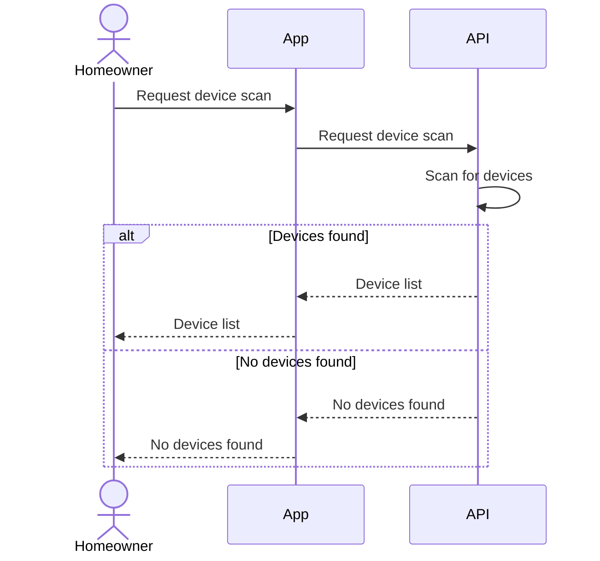
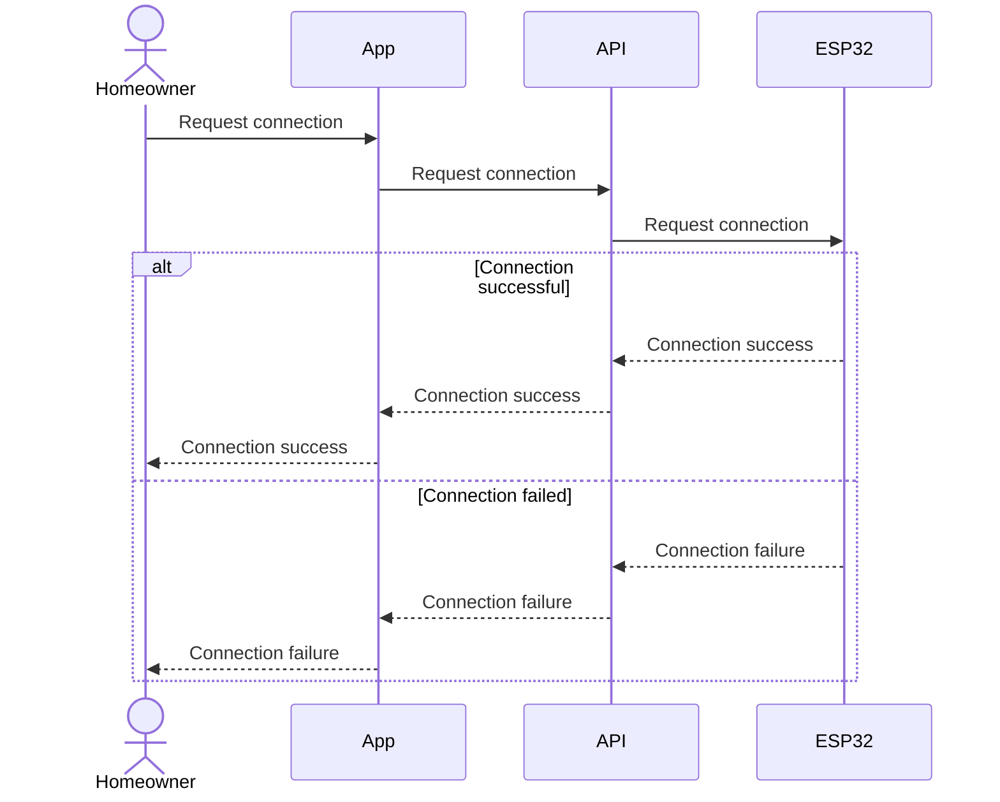

## Sequence 1: Device scanning
### participant:
- **Home Owner:** The user who wants to scan a device.
- **Mobile App:** The UI that send the scan request.
- **Web API:** Receives the request and responses with a device list.

## Sequence 2: ESP32 Connection

